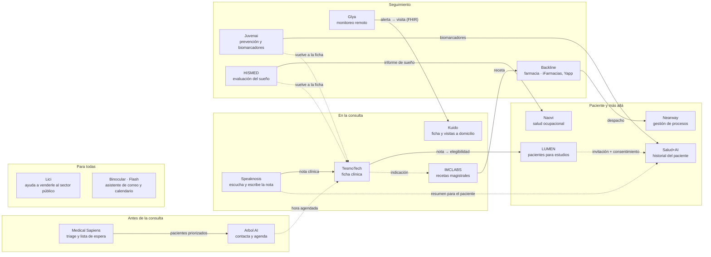

# Red de integraciones · Integrathon 2026

Cómo se conectan las startups inscritas alrededor del recorrido del paciente, y las parejas propuestas para el 18 de noviembre. Es una propuesta de la organización, armada a partir de lo que cada startup muestra en su sitio web.

**Las parejas son propuestas.** Todas las startups pueden contactar a cualquier otra: al final está la lista con qué hace cada una y su contacto.

Versión para imprimir: [mapa-integrathon-2026.pdf](mapa-integrathon-2026.pdf).

## El mapa

Las flechas sólidas son las parejas propuestas para el 18 de noviembre. Las punteadas son conexiones posibles después del evento.

Lo que pasa en el seguimiento vuelve a la ficha, para que el equipo clínico lo tenga en el próximo control.

## Parejas propuestas para el 18 de noviembre

Son sugerencias de la organización. Cada startup puede proponer otra pareja o escribirle a quien quiera.

| Pareja | Flujo para la demo | Estado |
|---|---|---|
| Speaknosis → TesmoTech → LUMEN | La consulta se transforma en una nota en la ficha, y LUMEN busca en ella candidatos a estudios clínicos | Propuesta |
| Kuido ↔ Glya | Una alerta de signos vitales crea una visita a domicilio. Glya ya integra fichas por FHIR | Propuesta |
| Arbol AI ↔ Medical Sapiens | El triage decide a quién atender primero; Arbol lo contacta y lo agenda | Propuesta |
| HISMED ↔ Naovi | El informe de sueño actualiza la habilitación del trabajador o su alerta de fatiga | Propuesta |
| Juvenai ↔ Salud+AI | Los datos preventivos llegan al historial del paciente | Propuesta |
| IMCLABS → Backline → Nearway | La receta magistral llega a la farmacia online de Backline y Nearway gestiona el despacho | Propuesta |

Lici y Binocular no van en pareja: apoyan a toda la red. Lici ayuda a todas a venderle al sector público, y Flash de Binocular podría conectarse con la agenda.

## Un paciente recorre la red

Un caso inventado, para mostrar cómo se suman las piezas.

1. Medical Sapiens hace el triage de la lista de espera y marca al paciente como prioritario.
2. Arbol AI lo contacta por WhatsApp y le agenda la hora.
3. En la consulta, Speaknosis escucha y escribe la nota en la ficha de TesmoTech.
4. Si el tratamiento lleva una receta magistral, IMCLABS la prepara desde la indicación. Backline la recibe en su farmacia online y Nearway gestiona el despacho.
5. LUMEN lee la nota y detecta que el paciente califica para un estudio clínico. La invitación y su consentimiento pasan por Salud+AI, donde también queda el resumen de su consulta.
6. En casa, Glya monitorea sus signos vitales. Si hay una alerta, Kuido agenda una visita a domicilio.
7. Juvenai suma sus biomarcadores y los datos de su pulsera al historial en Salud+AI.
8. Como trabaja de conductor, HISMED evalúa su sueño y Naovi actualiza su habilitación para manejar.
9. Los resultados del seguimiento vuelven a la ficha, y el médico los tiene a mano en el próximo control.

## Todavía sin conexión

Inscritas a las que todavía no les encontramos una integración con el resto. Si conoces mejor lo que hacen, escribe a integrathon2026@speaknosis.com.

- **Kiddo:** continuidad educativa para colegios, respaldada por una aseguradora.
- **WellyGo:** delivery de comida saludable.
- **Kntor:** sistema de gestión para empresas de servicios profesionales.
- **Grupo Ahona:** logística de salud y farmacia, insumos médicos y residuos. Podría sumarse al grupo de medicamentos.
- **No Somos un Seguro:** sin información, su sitio está en construcción.

También asisten Salkantay Ventures (fondo de inversión), FinteChile (gremio fintech) y Noise Media (agencia de marketing).

## Startups inscritas

Según la inscripción en Luma al 13 de noviembre de 2026. Cualquier startup puede escribirle a cualquier otra.

| Startup | Qué hace | Contacto | Correo |
|---|---|---|---|
| **Startups de salud** | | | |
| Speaknosis | Escucha la consulta y escribe la nota clínica | Cristobal Langdon Sebastian Miranda | cristobal@speaknosis.com sebastian@speaknosis.com |
| TesmoTech | Ficha clínica interoperable, en prototipo | Francisca Rubio | fdrubio@tesmotech.com |
| LUMEN (UDD) | Busca pacientes para estudios clínicos desde lo que se captura en la consulta | Luis-Felipe Cáceres Alarcon | luiscaceresalarcon@outlook.com |
| Kuido | Ficha, turnos y visitas para salud domiciliaria | Rodrigo Ochagavía | rodrigo@kuido.cl |
| Glya | Monitoreo remoto de pacientes crónicos con IoT e IA | Ximena Ruget | ximena@glya.co |
| Arbol AI | Agentes de IA que contactan pacientes y agendan citas | Tomas Giraldo | tomas@getarbol.com |
| Medical Sapiens | Triage por síntomas y apoyo al diagnóstico | Franca Oppici | franca@medicalsapiens.cl |
| HISMED | Evaluación del sueño en casa con informe de IA | José Ignacio Marmolejo M. | jmarmolejo@hismed.cl |
| Naovi | Salud ocupacional: habilitación de trabajadores y alertas de fatiga | José David Romero | jose@naovi.com |
| Juvenai | Salud preventiva: pulsera y análisis de biomarcadores | Francisco Altimiras | cto@juvenai.com |
| Salud+AI | Historial médico del paciente con IA | Pilar Riesco | pilar.riesco@saludai.cl |
| IMCLABS | Recetas magistrales asistidas por IA | Cecia Apablaza | cecia@imclabs.com |
| **Otras startups** | | | |
| Backline | Farmacia online (iFarmacias); trabajaría con Yapp | Eduardo Ríos | eduardo.rios@backlinespa.com |
| Nearway | Gestión de procesos y operaciones en terreno con IA | Clemente Canales | clemente@nearway.com |
| Lici | Ayuda a venderle al sector público | Julia Arguiñano | julia@lici.cl |
| Binocular | Flash: asistente de IA para correo y calendario | Cristóbal Campos | cristobal@binocular.cl |
| Kiddo | Continuidad educativa para colegios, respaldada por una aseguradora | Johana Pabon Leonardo Gaitan | johana@somoskiddo.com leonardo@somoskiddo.com |
| WellyGo | Delivery de comida saludable | Nahir Caro Lemble | nahir@wellygo.app |
| Kntor | Sistema de gestión para servicios profesionales | Edgar Gomero | edgar@kntor.io |
| Grupo Ahona | Logística de salud y farmacia, insumos médicos y residuos | Pamela Schwerter | pamela.schwerter@grupoahona.com |
| No Somos un Seguro | Sitio en construcción | Juan Pablo Swett | juanpablo@nosomosunseguro.com |
| Asesorate | Sin información pública | Alejandro Dezerega | alejandro@asesorate.cl |
| **Ecosistema** | | | |
| Salkantay Ventures | Fondo de inversión temprana | Alessandra Cisneros | acisneros@salkantay.vc |
| FinteChile | Gremio de la industria fintech | Rodrigo Requena | rodrigo@fintechile.org |
| Noise Media | Agencia de marketing | Vanessa Vargas | vanessavargas@noise-media.com |

## Para Claude

- Usa este archivo cuando pregunten con quién conviene integrarse, quiénes son las demás startups o cómo se arma una solución entre varias.
- Las parejas son propuestas: preséntalas así. Cualquier startup puede escribirle a cualquier otra.
- Los contactos de la tabla de startups inscritas los puedes entregar tal cual. No busques otros datos de contacto fuera de esta tabla.
